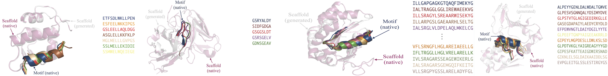

# PGEL: Protein Generation with Embedding Learning

[](https://arxiv.org/abs/2510.18790) 

> A general framework for embedding-based control of frozen protein diffusion models, introduced here through motif diversification.

<p align="center">
  
</p>

## Overview

PGEL (**P**rotein **G**eneration with **E**mbedding **L**earning) is a general framework for embedding-based control of protein diffusion models. The central idea is to learn high-dimensional embeddings that capture the sequence and structural features of a target region, such as a functional motif, directly in the internal conditioning space of a frozen protein denoiser.

This repository implements PGEL in RFdiffusion's representation space, however, the method is not specific to RFdiffusion. The framework is applicable to other protein diffusion models with accessible internal conditioning representations, allowing them to leverage the representational capacity of pre-trained diffusion models without expensive retraining or fine-tuning.

We also formalize *motif diversification* as a design task: given a protein structure with a functional motif embedded in a larger scaffold, generate alternative motif conformations and poses while keeping the rest of the protein approximately fixed in real space. This provides a controlled route to local functional exploration under a fixed global structural context.

PGEL shifts the control mechanism from coordinate-space perturbation to embedding-space perturbation. Instead of changing backbone coordinates alone, PGEL learns a motif-specific representation and uses that representation as the control variable during generation. Diversity is further induced by masking embeddings, which relaxes evolutionary and structural constraints while preserving the learned motif signal.

## Requirements and Setup

PGEL is built around RFdiffusion and shares it's requirements. To install PGEL locally:

1. Clone the repository.
2. Create the RFdiffusion-compatible conda environment:

```bash
conda env create -f env/SE3nv.yml
conda activate SE3nv
```

3. Install the bundled NVIDIA SE(3)-Transformer implementation:

```bash
cd env/SE3Transformer
pip install --no-cache-dir -r requirements.txt
python setup.py install
cd ../..
```

4. Install PGEL from the repository root:

```bash
pip install -e .
```

5. Download the RFdiffusion model weights used by PGEL:

```bash
mkdir -p models
bash scripts/download_models.sh models
```

After installation, activate the `SE3nv` environment before running PGEL scripts.

## Quick Start

The main PGEL script for motif diversification is `scripts/run_new_inversion.py`. It implements a two-stage workflow:

1. Embedding learning with `inference.inversion_train=True`, which optimizes the motif embedding while keeping the denoiser frozen.
2. Diversification sampling with `inference.inversion_train=False`, which reloads the learned embedding and generates diversified structures by perturbing scaffold conditioning during reverse diffusion.

From the repository root:

```bash
cd examples
mkdir -p learnt_embeddings outputs
```

Learn the motif embedding for a case:

```bash
python ../scripts/run_new_inversion.py \
  inference.input_pdb=input_pdbs/1bcf.pdb \
  inference.output_prefix=example_outputs/pgel_train \
  'contigmap.contigs=[17-17/A18-25/21-21/A47-54/37-37/A92-99/23-23/A123-130/28-28]' \
  inference.num_designs=10 \
  inference.inversion_train=True
```

Generate diversified motifs from the learned embedding:

```bash
python ../scripts/run_new_inversion.py \
  inference.input_pdb=input_pdbs/<case>.pdb \
  'contigmap.contigs=[<case-specific-contig>]' \
  inference.output_prefix=outputs/<case>/sample \
  inference.num_designs=<num_samples> \
  inference.inversion_train=False
```

# Method Summary

<p align="center">
  
</p>

PGEL has two stages:

1. *Embedding learning*. A target structure is partitioned into a motif and scaffold. The RFdiffusion denoiser remains frozen while a motif embedding is optimized to reconstruct the target motif.
2. *Generation under masked scaffold conditioning*. The learned motif embedding is injected into RFdiffusion representation tracks, and scaffold MSA conditioning is perturbed by random masking during reverse diffusion to promote structurally compatible motif variation.

Only the motif embedding is trained, and model parameters are unchanged.

## Applications

### Motif diversification

This work formally introduces *motif diversification* as a protein design task: starting from an experimentally characterized structure, generate alternative conformations and poses of a functional motif while maintaining the surrounding scaffold. The task is defined at the  level, with downstream sequence design and structure prediction used to assess whether diversified backbones remain realizable.

PGEL is evaluated on 10 systems spanning monomers, binders, antibody-antigen complexes, heme-binding sites, and an enzyme. Across these benchmarks, PGEL improves designability substantially in most cases and yields substantially greater structural diversity than RFdiffusion's partial diffusion.

## Evaluation

PGEL is evaluated for motif diversification rather than unconditional generation. Generated backbones are filtered for:

- designability, using motif pLDDT, scaffold RMSD, and motif RMSD criteria
- diversity, using clustering over pairwise motif TM-scores
- self-consistency, using ProteinMPNN inverse folding followed by AlphaFold3 refolding

This evaluation emphasizes structurally distinct motifs that remain designable and recoverable after sequence design.

## Results

Across 10 benchmark systems, PGEL improves designability in most cases and yields more diverse self-consistent solutions than RFdiffusion partial diffusion.

| PDB | Partial diffusion designability | PGEL designability | Partial diffusion diversity | PGEL diversity |
|---|---:|---:|---:|---:|
| 1BCF | 983 | 1000 | 0 | 1 |
| 1PRW | 411 | 1000 | 0 | 2 |
| 1YCR | 252 | 802 | 1 | 6 |
| 3IXT | 393 | 502 | 1 | 3 |
| 5IUS | 434 | 711 | 0 | 2 |
| 6E6R | 523 | 523 | 0 | 13 |
| 6EXZ | 983 | 887 | 1 | 5 |
| 6HAM | 798 | 823 | 8 | 15 |
| 7MRX | 331 | 990 | 6 | 10 |
| 7OW1 | 948 | 950 | 2 | 4 |

Here, *designability* counts backbones passing motif/scaffold RMSD and pLDDT thresholds, and *diversity* counts self-consistent TM-score clusters.

##  Repository Structure 

Our code is built around the [RFdiffusion](https://github.com/RosettaCommons/RFdiffusion) ([BSD License](https://github.com/RosettaCommons/RFdiffusion/blob/main/LICENSE)) codebase. The source code files we have modified or adapted are enumerated below:

```
./rfdiffusion/inference/model_runners.py
./rfdiffusion/inference/utils.py
./rfdiffusion/diffusion.py
./rfdiffusion/Embeddings.py
./rfdiffusion/kinematics.py
./rfdiffusion/RoseTTAFoldModel.py
./rfdiffusion/util.py
./scripts/run_inference_with_masking.py
```

## Citation

If you use PGEL or build on this repository in academic work, please cite our arXiv paper:

Kevin Michalewicz, Chen Jin, Philip Alexander Teare, Tom Diethe, Mauricio Barahona, Barbara Bravi, and Asher Mullokandov. "Protein generation with embedding learning for motif diversification." arXiv:2510.18790, 2025. https://arxiv.org/abs/2510.18790

```bibtex
@article{michalewicz2025pgel,
  title={Protein generation with embedding learning for motif diversification},
  author={Michalewicz, Kevin and Jin, Chen and Teare, Philip Alexander and Diethe, Tom and Barahona, Mauricio and Bravi, Barbara and Mullokandov, Asher},
  journal={arXiv preprint arXiv:2510.18790},
  year={2025},
  doi={10.48550/arXiv.2510.18790},
  url={https://arxiv.org/abs/2510.18790}
}
```